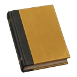
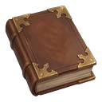

# Items

**Total de ítems** · 107

## Índice por categoría

* [Botín de enemigos](./#categoría-1) · 5
* [Comida](./#categoría-2) · 22
* [Correspondencia](./#categoría-3) · 1
* [Escritura](./#categoría-4) · 8
* [Especiales](./#categoría-5) · 1
* [Herramientas](./#categoría-6) · 4
* [Libros de hechizos · Artes Oscuras](./#categoría-7) · 3
* [Libros de hechizos · Control](./#categoría-8) · 4
* [Libros de hechizos · Daño](./#categoría-9) · 4
* [Libros de hechizos · Fuerza](./#categoría-10) · 4
* [Materiales](./#categoría-11) · 14
* [Objetos del santuario](./#categoría-12) · 1
* [Plantas utilizables](./#categoría-13) · 3
* [Pociones utilizables](./#categoría-14) · 7
* [Productos de bestias](./#categoría-15) · 13
* [Productos de plantas](./#categoría-16) · 5
* [Pruebas](./#categoría-17) · 1
* [Recolectables](./#categoría-18) · 5
* [Recursos](./#categoría-19) · 2

## Categoría 1

**Botín de enemigos** · 5

| Icono                                                                                | Nombre                | ID              | Origen  | Tipo      | Holder            | Stack | Inventariable | Persistente | Consumible | Kind |
| ------------------------------------------------------------------------------------ | --------------------- | --------------- | ------- | --------- | ----------------- | ----- | ------------- | ----------- | ---------- | ---- |
|     | **Colmillo de araña** | Spider\_Fang    | Nativos | EnemyDrop | ResourceInventory | 999   | Sí            | No          | No         | item |
|    | **Lengua de dugbog**  | Dugbog\_Pellet  | Nativos | EnemyDrop | ResourceInventory | 999   | Sí            | No          | No         | item |
|      | **Moco de trol**      | TrollMucus      | Nativos | EnemyDrop | ResourceInventory | 999   | Sí            | No          | Sí         | item |
|           | **Olor de muerto**    | StenchOfTheDead | Nativos | EnemyDrop | ResourceInventory | 999   | Sí            | No          | No         | item |
|  | **Piel de lobo**      | Wolf\_Byproduct | Nativos | EnemyDrop | ResourceInventory | 999   | Sí            | No          | No         | item |

## Categoría 2

**Comida** · 22

| Icono                                                                               | Nombre                   | ID            | Origen               | Tipo | Holder | Stack | Inventariable | Persistente | Consumible | Kind |
| ----------------------------------------------------------------------------------- | ------------------------ | ------------- | -------------------- | ---- | ------ | ----- | ------------- | ----------- | ---------- | ---- |
|            | **Azúcar**               | sugar         | Personalizados Lumos | —    | —      | 999   | —             | —           | —          | —    |
|            | **Cacao**                | cocoa         | Personalizados Lumos | —    | —      | 999   | —             | —           | —          | —    |
|         | **Canela**               | cinnamon      | Personalizados Lumos | —    | —      | 999   | —             | —           | —          | —    |
|             | **Carne**                | meat          | Personalizados Lumos | —    | —      | 999   | —             | —           | —          | —    |
|     | **Comida en mal estado** | spoiledfood   | Personalizados Lumos | —    | —      | 999   | —             | —           | —          | —    |
|           | **Especias**             | spices        | Personalizados Lumos | —    | —      | 999   | —             | —           | —          | —    |
|            | **Fruta**                | fruit         | Personalizados Lumos | —    | —      | 999   | —             | —           | —          | —    |
|             | **Frutos secos**         | nuts          | Personalizados Lumos | —    | —      | 999   | —             | —           | —          | —    |
|            | **Grano**                | grain         | Personalizados Lumos | —    | —      | 999   | —             | —           | —          | —    |
|     | **Granos de café**       | coffeebeans   | Personalizados Lumos | —    | —      | 999   | —             | —           | —          | —    |
|            | **Harina**               | flour         | Personalizados Lumos | —    | —      | 999   | —             | —           | —          | —    |
|       | **Hojas de té**          | tealeaves     | Personalizados Lumos | —    | —      | 999   | —             | —           | —          | —    |
|             | **Huevos**               | eggs          | Personalizados Lumos | —    | —      | 999   | —             | —           | —          | —    |
|             | **Malta**                | malt          | Personalizados Lumos | —    | —      | 999   | —             | —           | —          | —    |
|            | **Miel**                 | honey         | Personalizados Lumos | —    | —      | 999   | —             | —           | —          | —    |
|            | **Nata**                 | cream         | Personalizados Lumos | —    | —      | 999   | —             | —           | —          | —    |
|         | **Patatas**              | potatoes      | Personalizados Lumos | —    | —      | 999   | —             | —           | —          | —    |
|             | **Pescado**              | fish          | Personalizados Lumos | —    | —      | 999   | —             | —           | —          | —    |
|   | **Queso cheddar**        | cheddarcheese | Personalizados Lumos | —    | —      | 999   | —             | —           | —          | —    |
|  | **Rueda de queso**       | wheelofcheese | Personalizados Lumos | —    | —      | 999   | —             | —           | —          | —    |
|        | **Setas**                | mushrooms     | Personalizados Lumos | —    | —      | 999   | —             | —           | —          | —    |
|       | **Verduras**             | vegetables    | Personalizados Lumos | —    | —      | 999   | —             | —           | —          | —    |

## Categoría 3

**Correspondencia** · 1

| Icono                                                                                                                          | Nombre            | ID             | Origen             | Tipo | Holder | Stack | Inventariable | Persistente | Consumible | Kind |
| ------------------------------------------------------------------------------------------------------------------------------ | ----------------- | -------------- | ------------------ | ---- | ------ | ----- | ------------- | ----------- | ---------- | ---- |
|  | **Sealed Letter** | sealed\_letter | Personalizados HMP | —    | —      | 20    | —             | —           | —          | —    |

* **Sealed Letter** · Owl post with an unbroken seal.

## Categoría 4

**Escritura** · 8

| Icono                                                                                        | Nombre                                     | ID                   | Origen               | Tipo | Holder | Stack | Inventariable | Persistente | Consumible | Kind |
| -------------------------------------------------------------------------------------------- | ------------------------------------------ | -------------------- | -------------------- | ---- | ------ | ----- | ------------- | ----------- | ---------- | ---- |
|           | **Pergamino en blanco**                    | blankparchment       | Personalizados Lumos | —    | —      | 999   | —             | —           | —          | —    |
|        | **Pluma de cisne**                         | swanfeatherquill     | Personalizados Lumos | —    | —      | 999   | —             | —           | —          | —    |
|  | **Sello de caucho y almohadilla de tinta** | rubberstampandinkpad | Personalizados Lumos | —    | —      | 999   | —             | —           | —          | —    |
|              | **Sello y lacre**                          | sealandwax           | Personalizados Lumos | —    | —      | 999   | —             | —           | —          | —    |
|           | **Sobre sellado**                          | sealedenvelope       | Personalizados Lumos | —    | —      | 999   | —             | —           | —          | —    |
|                  | **Tinta azul**                             | blueink              | Personalizados Lumos | —    | —      | 999   | —             | —           | —          | —    |
|                   | **Tinta roja**                             | redink               | Personalizados Lumos | —    | —      | 999   | —             | —           | —          | —    |
|             | **Tintero**                                | bottleofink          | Personalizados Lumos | —    | —      | 999   | —             | —           | —          | —    |

## Categoría 5

**Especiales** · 1

| Icono                                                                          | Nombre       | ID    | Origen  | Tipo    | Holder            | Stack | Inventariable | Persistente | Consumible | Kind |
| ------------------------------------------------------------------------------ | ------------ | ----- | ------- | ------- | ----------------- | ----- | ------------- | ----------- | ---------- | ---- |
|  | **Galleons** | Knuts | Nativos | Special | ResourceInventory | 999   | Sí            | No          | No         | item |

## Categoría 6

**Herramientas** · 4

| Icono                                                                               | Nombre                | ID             | Origen               | Tipo | Holder | Stack | Inventariable | Persistente | Consumible | Kind |
| ----------------------------------------------------------------------------------- | --------------------- | -------------- | -------------------- | ---- | ------ | ----- | ------------- | ----------- | ---------- | ---- |
|  | **Caldero de cobre**  | coppercauldron | Personalizados Lumos | —    | —      | 999   | —             | —           | —          | —    |
|   | **Caldero de latón**  | brasscauldron  | Personalizados Lumos | —    | —      | 999   | —             | —           | —          | —    |
|  | **Caldero de peltre** | pewtercauldron | Personalizados Lumos | —    | —      | 999   | —             | —           | —          | —    |
|  | **Caldero de plata**  | silvercauldron | Personalizados Lumos | —    | —      | 999   | —             | —           | —          | —    |

## Categoría 7

**Libros de hechizos · Artes Oscuras** · 3

| Icono                                                                                     | Nombre                       | ID                    | Origen               | Tipo | Holder | Stack | Inventariable | Persistente | Consumible | Kind |
| ----------------------------------------------------------------------------------------- | ---------------------------- | --------------------- | -------------------- | ---- | ------ | ----- | ------------- | ----------- | ---------- | ---- |
|  | **Tratado de Avada Kedavra** | libro\_avada\_kedavra | Personalizados Lumos | —    | —      | 10    | —             | —           | No         | —    |
|  | **Tratado de Crucio**        | libro\_crucio         | Personalizados Lumos | —    | —      | 10    | —             | —           | No         | —    |
|  | **Tratado de Imperio**       | libro\_imperio        | Personalizados Lumos | —    | —      | 10    | —             | —           | No         | —    |

* **Tratado de Avada Kedavra** · Artes Oscuras. Enseña Avada Kedavra al leerlo. El libro se consume al aprender el hechizo.
* **Tratado de Crucio** · Artes Oscuras. Enseña Crucio al leerlo. El libro se consume al aprender el hechizo.
* **Tratado de Imperio** · Artes Oscuras. Enseña Imperio al leerlo. El libro se consume al aprender el hechizo.

## Categoría 8

**Libros de hechizos · Control** · 4

| Icono                                                                                   | Nombre                          | ID                       | Origen               | Tipo | Holder | Stack | Inventariable | Persistente | Consumible | Kind |
| --------------------------------------------------------------------------------------- | ------------------------------- | ------------------------ | -------------------- | ---- | ------ | ----- | ------------- | ----------- | ---------- | ---- |
|  | **Tratado de Arresto Momentum** | libro\_arresto\_momentum | Personalizados Lumos | —    | —      | 10    | —             | —           | No         | —    |
|  | **Tratado de Glacius**          | libro\_glacius           | Personalizados Lumos | —    | —      | 10    | —             | —           | No         | —    |
|  | **Tratado de Levioso**          | libro\_levioso           | Personalizados Lumos | —    | —      | 10    | —             | —           | No         | —    |
|  | **Tratado de Transformación**   | libro\_transformacion    | Personalizados Lumos | —    | —      | 10    | —             | —           | No         | —    |

* **Tratado de Arresto Momentum** · Control · Amarillo. Enseña Arresto Momentum al leerlo. El libro se consume al aprender el hechizo.
* **Tratado de Glacius** · Control · Amarillo. Enseña Glacius al leerlo. El libro se consume al aprender el hechizo.
* **Tratado de Levioso** · Control · Amarillo. Enseña Levioso al leerlo. El libro se consume al aprender el hechizo.
* **Tratado de Transformación** · Control · Amarillo. Enseña Transformación al leerlo. El libro se consume al aprender el hechizo.

## Categoría 9

**Libros de hechizos · Daño** · 4

| Icono                                                                                | Nombre                      | ID                  | Origen               | Tipo | Holder | Stack | Inventariable | Persistente | Consumible | Kind |
| ------------------------------------------------------------------------------------ | --------------------------- | ------------------- | -------------------- | ---- | ------ | ----- | ------------- | ----------- | ---------- | ---- |
|  | **Tratado de Bombarda**     | libro\_bombarda     | Personalizados Lumos | —    | —      | 10    | —             | —           | No         | —    |
|  | **Tratado de Confringo**    | libro\_confringo    | Personalizados Lumos | —    | —      | 10    | —             | —           | No         | —    |
|  | **Tratado de Expelliarmus** | libro\_expelliarmus | Personalizados Lumos | —    | —      | 10    | —             | —           | No         | —    |
|  | **Tratado de Incendio**     | libro\_incendio     | Personalizados Lumos | —    | —      | 10    | —             | —           | No         | —    |

* **Tratado de Bombarda** · Daño · Rojo. Enseña Bombarda al leerlo. El libro se consume al aprender el hechizo.
* **Tratado de Confringo** · Daño · Rojo. Enseña Confringo al leerlo. El libro se consume al aprender el hechizo.
* **Tratado de Expelliarmus** · Daño · Rojo. Enseña Expelliarmus al leerlo. El libro se consume al aprender el hechizo.
* **Tratado de Incendio** · Daño · Rojo. Enseña Incendio al leerlo. El libro se consume al aprender el hechizo.

## Categoría 10

**Libros de hechizos · Fuerza** · 4

| Icono                                                                                   | Nombre                  | ID              | Origen               | Tipo | Holder | Stack | Inventariable | Persistente | Consumible | Kind |
| --------------------------------------------------------------------------------------- | ----------------------- | --------------- | -------------------- | ---- | ------ | ----- | ------------- | ----------- | ---------- | ---- |
|  | **Tratado de Accio**    | libro\_accio    | Personalizados Lumos | —    | —      | 10    | —             | —           | No         | —    |
|  | **Tratado de Depulso**  | libro\_depulso  | Personalizados Lumos | —    | —      | 10    | —             | —           | No         | —    |
|  | **Tratado de Descendo** | libro\_descendo | Personalizados Lumos | —    | —      | 10    | —             | —           | No         | —    |
|  | **Tratado de Flipendo** | libro\_flipendo | Personalizados Lumos | —    | —      | 10    | —             | —           | No         | —    |

* **Tratado de Accio** · Fuerza · Morado. Enseña Accio al leerlo. El libro se consume al aprender el hechizo.
* **Tratado de Depulso** · Fuerza · Morado. Enseña Depulso al leerlo. El libro se consume al aprender el hechizo.
* **Tratado de Descendo** · Fuerza · Morado. Enseña Descendo al leerlo. El libro se consume al aprender el hechizo.
* **Tratado de Flipendo** · Fuerza · Morado. Enseña Flipendo al leerlo. El libro se consume al aprender el hechizo.

## Categoría 11

**Materiales** · 14

| Icono                                                                               | Nombre                 | ID            | Origen               | Tipo | Holder | Stack | Inventariable | Persistente | Consumible | Kind |
| ----------------------------------------------------------------------------------- | ---------------------- | ------------- | -------------------- | ---- | ------ | ----- | ------------- | ----------- | ---------- | ---- |
|     | **Botella de cristal** | glassbottle   | Personalizados Lumos | —    | —      | 20    | —             | —           | —          | —    |
|          | **Cera de abeja**      | beeswax       | Personalizados Lumos | —    | —      | 999   | —             | —           | —          | —    |
|          | **Cuero**              | leather       | Personalizados Lumos | —    | —      | 999   | —             | —           | —          | —    |
|           | **Hilo**               | thread        | Personalizados Lumos | —    | —      | 999   | —             | —           | —          | —    |
|         | **Lana sin procesar**  | rawwool       | Personalizados Lumos | —    | —      | 999   | —             | —           | —          | —    |
|            | **Metal**              | metal         | Personalizados Lumos | —    | —      | 999   | —             | —           | —          | —    |
|  | **Oro y plata**        | goldandsilver | Personalizados Lumos | —    | —      | 999   | —             | —           | —          | —    |
|     | **Ovillo de lana**     | ballofyarn    | Personalizados Lumos | —    | —      | 999   | —             | —           | —          | —    |
|            | **Paja**               | straw         | Personalizados Lumos | —    | —      | 999   | —             | —           | —          | —    |
|         | **Piedra preciosa**    | gemstone      | Personalizados Lumos | —    | —      | 999   | —             | —           | —          | —    |
|      | **Piel de dragón**     | dragonhide    | Personalizados Lumos | —    | —      | 999   | —             | —           | —          | —    |
|         | **Plumas**             | feathers      | Personalizados Lumos | —    | —      | 999   | —             | —           | —          | —    |
|            | **Tela**               | cloth         | Personalizados Lumos | —    | —      | 999   | —             | —           | —          | —    |
|              | **Tinte**              | dye           | Personalizados Lumos | —    | —      | 999   | —             | —           | —          | —    |

* **Botella de cristal** · Recipiente vacío para preparar pociones.

## Categoría 12

**Objetos del santuario** · 1

| Icono                                                                                     | Nombre    | ID         | Origen  | Tipo          | Holder            | Stack | Inventariable | Persistente | Consumible | Kind |
| ----------------------------------------------------------------------------------------- | --------- | ---------- | ------- | ------------- | ----------------- | ----- | ------------- | ----------- | ---------- | ---- |
|  | **Abono** | Fertiliser | Nativos | SanctuaryItem | ResourceInventory | 999   | Sí            | No          | No         | item |

## Categoría 13

**Plantas utilizables** · 3

| Icono                                                                                        | Nombre                    | ID                           | Origen  | Tipo        | Holder         | Stack | Inventariable | Persistente | Consumible | Kind |
| -------------------------------------------------------------------------------------------- | ------------------------- | ---------------------------- | ------- | ----------- | -------------- | ----- | ------------- | ----------- | ---------- | ---- |
|  | **Col masticadora china** | ChompingCabbage\_Byproduct   | Nativos | PlantUsable | SanctuaryWheel | 12    | Sí            | No          | Sí         | item |
|      | **Mandrágora**            | Mandrake\_Byproduct          | Nativos | PlantUsable | SanctuaryWheel | 12    | Sí            | No          | Sí         | item |
|                        | **Tentácula venenosa**    | VenomousTentacula\_Byproduct | Nativos | PlantUsable | SanctuaryWheel | 12    | Sí            | No          | Sí         | item |

## Categoría 14

**Pociones utilizables** · 7

| Icono                                                                                    | Nombre                      | ID                 | Origen  | Tipo         | Holder              | Stack | Inventariable | Persistente | Consumible | Kind |
| ---------------------------------------------------------------------------------------- | --------------------------- | ------------------ | ------- | ------------ | ------------------- | ----- | ------------- | ----------- | ---------- | ---- |
|        | **Felix Felicis**           | FelixFelicis       | Nativos | PotionUsable | SanctuaryWheel      | 12    | Sí            | No          | Sí         | item |
|        | **Poción de concentración** | AMFillPotion       | Nativos | PotionUsable | SanctuaryWheel      | 12    | Sí            | No          | Sí         | item |
|  | **Poción de invisibilidad** | InvisibilityPotion | Nativos | PotionUsable | SanctuaryWheel      | 12    | Sí            | No          | Sí         | item |
|              | **Poción edurus**           | Edurus             | Nativos | PotionUsable | SanctuaryWheel      | 12    | Sí            | No          | Sí         | item |
|       | **Poción herbovitalizante** | WoundCleaning      | Nativos | PotionUsable | HealthPotionStorage | 25    | Sí            | No          | Sí         | item |
|              | **Poción máxima**           | Maxima             | Nativos | PotionUsable | SanctuaryWheel      | 12    | Sí            | No          | Sí         | item |
|    | **Prepararayo**             | AutoDamagePotion   | Nativos | PotionUsable | SanctuaryWheel      | 12    | Sí            | No          | Sí         | item |

## Categoría 15

**Productos de bestias** · 13

| Icono                                                                                           | Nombre                   | ID                     | Origen  | Tipo           | Holder            | Stack | Inventariable | Persistente | Consumible | Kind |
| ----------------------------------------------------------------------------------------------- | ------------------------ | ---------------------- | ------- | -------------- | ----------------- | ----- | ------------- | ----------- | ---------- | ---- |
|         | **Cuerno de graphorn**   | Graphorn\_Byproduct    | Nativos | BeastByProduct | ResourceInventory | 999   | Sí            | No          | No         | item |
|          | **Pelaje de escarbato**  | Niffler\_Byproduct     | Nativos | BeastByProduct | ResourceInventory | 999   | Sí            | No          | No         | item |
|          | **Pelaje de kneazle**    | Kneazle\_Byproduct     | Nativos | BeastByProduct | ResourceInventory | 999   | Sí            | No          | No         | item |
|                | **Pelaje de mooncalf**   | Mooncalf\_Byproduct    | Nativos | BeastByProduct | ResourceInventory | 999   | Sí            | No          | No         | item |
|  | **Pelaje de puffskein**  | Puffskein\_Byproduct   | Nativos | BeastByProduct | ResourceInventory | 999   | Sí            | No          | No         | item |
|         | **Pelaje de thestral**   | Thestral\_Byproduct    | Nativos | BeastByProduct | ResourceInventory | 999   | Sí            | No          | No         | item |
|          | **Pelo de unicornio**    | Unicorn\_Byproduct     | Nativos | BeastByProduct | ResourceInventory | 999   | Sí            | No          | No         | item |
|         | **Pluma de diricawl**    | Diricawl\_Byproduct    | Nativos | BeastByProduct | ResourceInventory | 999   | Sí            | No          | No         | item |
|                    | **Pluma de fénix**       | Phoenix\_Byproduct     | Nativos | BeastByProduct | ResourceInventory | 999   | Sí            | No          | No         | item |
|             | **Pluma de fwooper**     | Fwooper\_Byproduct     | Nativos | BeastByProduct | ResourceInventory | 999   | Sí            | No          | No         | item |
|       | **Pluma de hipogrifo**   | Hippogriff\_Byproduct  | Nativos | BeastByProduct | ResourceInventory | 999   | Sí            | No          | No         | item |
|      | **Pluma de jobberknoll** | Jobberknoll\_Byproduct | Nativos | BeastByProduct | ResourceInventory | 999   | Sí            | No          | No         | item |
|             | **Verruga de sapo**      | Toad\_Byproduct        | Nativos | BeastByProduct | ResourceInventory | 999   | Sí            | No          | No         | item |

## Categoría 16

**Productos de plantas** · 5

| Icono                                                                                       | Nombre                           | ID                     | Origen  | Tipo           | Holder            | Stack | Inventariable | Persistente | Consumible | Kind |
| ------------------------------------------------------------------------------------------- | -------------------------------- | ---------------------- | ------- | -------------- | ----------------- | ----- | ------------- | ----------- | ---------- | ---- |
|    | **Brotes de descurainia**        | Knotgrass\_Byproduct   | Nativos | PlantByProduct | ResourceInventory | 999   | Sí            | No          | No         | item |
|   | **Fruto de higuera hidropónica** | Shrivelfig\_Byproduct  | Nativos | PlantByProduct | ResourceInventory | 999   | Sí            | No          | No         | item |
|                | **Hojas de dictamo**             | Dittany\_Byproduct     | Nativos | PlantByProduct | ResourceInventory | 999   | Sí            | No          | No         | item |
|  | **Hojas de malva**               | Mallowsweet\_Byproduct | Nativos | PlantByProduct | ResourceInventory | 999   | Sí            | No          | No         | item |
|         | **Tallo de descurainia sophia**  | Fluxweed\_Byproduct    | Nativos | PlantByProduct | ResourceInventory | 999   | Sí            | No          | No         | item |

## Categoría 17

**Pruebas** · 1

| Icono                                                                                                                          | Nombre           | ID            | Origen             | Tipo | Holder | Stack | Inventariable | Persistente | Consumible | Kind |
| ------------------------------------------------------------------------------------------------------------------------------ | ---------------- | ------------- | ------------------ | ---- | ------ | ----- | ------------- | ----------- | ---------- | ---- |
|  | **Evidence Bag** | evidence\_bag | Personalizados HMP | —    | —      | 1     | —             | —           | —          | —    |

* **Evidence Bag** · A tagged bag for recovered evidence.

## Categoría 18

**Recolectables** · 5

| Icono                                                                                            | Nombre                              | ID                          | Origen  | Tipo       | Holder            | Stack | Inventariable | Persistente | Consumible | Kind |
| ------------------------------------------------------------------------------------------------ | ----------------------------------- | --------------------------- | ------- | ---------- | ----------------- | ----- | ------------- | ----------- | ---------- | ---- |
|               | **Crisopos**                        | LacewingFlies               | Nativos | Forageable | ResourceInventory | 999   | Sí            | No          | No         | item |
|               | **Huevo de ashwinder**              | AshwinderEggs               | Nativos | Forageable | ResourceInventory | 999   | Sí            | No          | No         | item |
|  | **Sombreros de champiñón saltarín** | LeapingToadstool\_Byproduct | Nativos | Forageable | ResourceInventory | 999   | Sí            | No          | No         | item |
|               | **Zumo de Horklump**                | HorklumpJuice               | Nativos | Forageable | ResourceInventory | 999   | Sí            | No          | No         | item |
|                  | **Zumo de sanguijuela**             | LeechJuice                  | Nativos | Forageable | ResourceInventory | 999   | Sí            | No          | No         | item |

## Categoría 19

**Recursos** · 2

| Icono                                                                           | Nombre           | ID        | Origen  | Tipo     | Holder            | Stack | Inventariable | Persistente | Consumible | Kind |
| ------------------------------------------------------------------------------- | ---------------- | --------- | ------- | -------- | ----------------- | ----- | ------------- | ----------- | ---------- | ---- |
|        | **Madera**       | Timber    | Nativos | Resource | ResourceInventory | 999   | Sí            | No          | No         | item |
|  | **Piedra lunar** | Moonstone | Nativos | Resource | ResourceInventory | 999   | Sí            | No          | No         | item |
