# inventory catalog

**Total de ítems:** 90

## Índice por categoría

* **Potion Usable** (7)
* **Forageable** (5)
* **Plant Usable** (3)
* **Beast By Product** (13)
* **Plant By Product** (5)
* **Enemy Drop** (5)
* **Sanctuary Item** (1)
* **Special** (1)
* **Resource** (50)

## Potion Usable

|                                                    Icono                                                    | Nombre                  | Item ID              | Tipo           | Holder                | Stack | Inventariable | Persistente | Consumible | Kind   |
| :---------------------------------------------------------------------------------------------------------: | ----------------------- | -------------------- | -------------- | --------------------- | ----: | :-----------: | :---------: | :--------: | ------ |
|    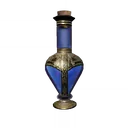    | Poción de concentración | `AMFillPotion`       | `PotionUsable` | `SanctuaryWheel`      |    12 |       Sí      |      No     |     Sí     | `item` |
|        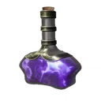        | Prepararayo             | `AutoDamagePotion`   | `PotionUsable` | `SanctuaryWheel`      |    12 |       Sí      |      No     |     Sí     | `item` |
|            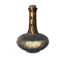            | Poción edurus           | `Edurus`             | `PotionUsable` | `SanctuaryWheel`      |    12 |       Sí      |      No     |     Sí     | `item` |
|         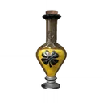         | Felix Felicis           | `FelixFelicis`       | `PotionUsable` | `SanctuaryWheel`      |    12 |       Sí      |      No     |     Sí     | `item` |
| 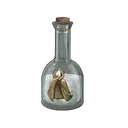 | Poción de invisibilidad | `InvisibilityPotion` | `PotionUsable` | `SanctuaryWheel`      |    12 |       Sí      |      No     |     Sí     | `item` |
|            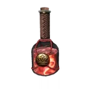            | Poción máxima           | `Maxima`             | `PotionUsable` | `SanctuaryWheel`      |    12 |       Sí      |      No     |     Sí     | `item` |
|       | Poción herbovitalizante | `WoundCleaning`      | `PotionUsable` | `HealthPotionStorage` |    25 |       Sí      |      No     |     Sí     | `item` |

## Forageable

|                                                            Icono                                                            | Nombre                          | Item ID                      | Tipo         | Holder              | Stack | Inventariable | Persistente | Consumible | Kind   |
| :-------------------------------------------------------------------------------------------------------------------------: | ------------------------------- | ---------------------------- | ------------ | ------------------- | ----: | :-----------: | :---------: | :--------: | ------ |
|              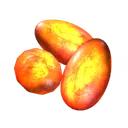              | Huevo de ashwinder              | `AshwinderEggs`              | `Forageable` | `ResourceInventory` |   999 |       Sí      |      No     |     No     | `item` |
|               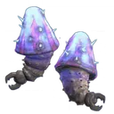               | Zumo de Horklump                | `HorklumpJuice`              | `Forageable` | `ResourceInventory` |   999 |       Sí      |      No     |     No     | `item` |
|                   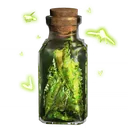                   | Crisopos                        | `LacewingFlies`              | `Forageable` | `ResourceInventory` |   999 |       Sí      |      No     |     No     | `item` |
| 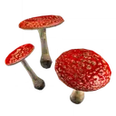 | Sombreros de champiñón saltarín | `LeapingToadstool_Byproduct` | `Forageable` | `ResourceInventory` |   999 |       Sí      |      No     |     No     | `item` |
|               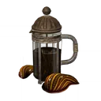               | Zumo de sanguijuela             | `LeechJuice`                 | `Forageable` | `ResourceInventory` |   999 |       Sí      |      No     |     No     | `item` |

## Plant Usable

|                                                     Icono                                                     | Nombre                | Item ID                       | Tipo          | Holder           | Stack | Inventariable | Persistente | Consumible | Kind   |
| :-----------------------------------------------------------------------------------------------------------: | --------------------- | ----------------------------- | ------------- | ---------------- | ----: | :-----------: | :---------: | :--------: | ------ |
| 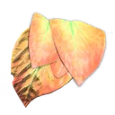 | Col masticadora china | `ChompingCabbage_Byproduct`   | `PlantUsable` | `SanctuaryWheel` |    12 |       Sí      |      No     |     Sí     | `item` |
|         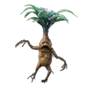        | Mandrágora            | `Mandrake_Byproduct`          | `PlantUsable` | `SanctuaryWheel` |    12 |       Sí      |      No     |     Sí     | `item` |
|              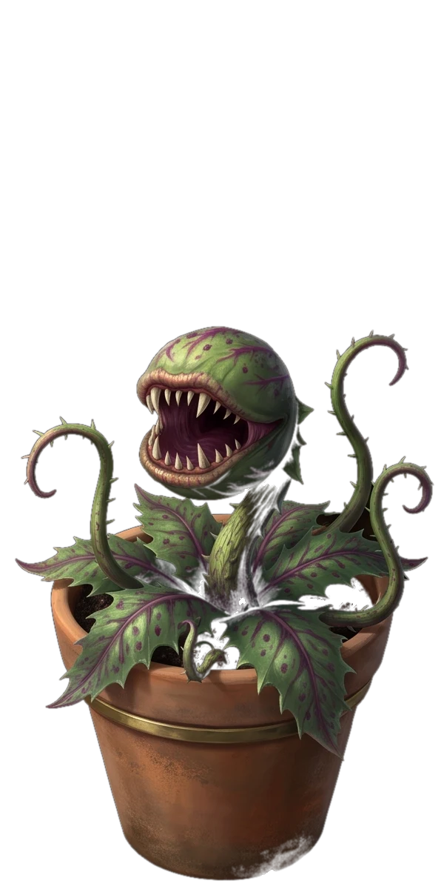             | Tentácula venenosa    | `VenomousTentacula_Byproduct` | `PlantUsable` | `SanctuaryWheel` |    12 |       Sí      |      No     |     Sí     | `item` |

## Beast By Product

|                                                      Icono                                                     | Nombre               | Item ID                 | Tipo             | Holder              | Stack | Inventariable | Persistente | Consumible | Kind   |
| :------------------------------------------------------------------------------------------------------------: | -------------------- | ----------------------- | ---------------- | ------------------- | ----: | :-----------: | :---------: | :--------: | ------ |
|      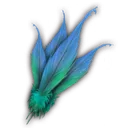     | Pluma de diricawl    | `Diricawl_Byproduct`    | `BeastByProduct` | `ResourceInventory` |   999 |       Sí      |      No     |     No     | `item` |
|        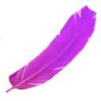        | Pluma de fwooper     | `Fwooper_Byproduct`     | `BeastByProduct` | `ResourceInventory` |   999 |       Sí      |      No     |     No     | `item` |
|          | Cuerno de graphorn   | `Graphorn_Byproduct`    | `BeastByProduct` | `ResourceInventory` |   999 |       Sí      |      No     |     No     | `item` |
|    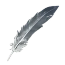    | Pluma de hipogrifo   | `Hippogriff_Byproduct`  | `BeastByProduct` | `ResourceInventory` |   999 |       Sí      |      No     |     No     | `item` |
|     | Pluma de jobberknoll | `Jobberknoll_Byproduct` | `BeastByProduct` | `ResourceInventory` |   999 |       Sí      |      No     |     No     | `item` |
|            | Pelaje de kneazle    | `Kneazle_Byproduct`     | `BeastByProduct` | `ResourceInventory` |   999 |       Sí      |      No     |     No     | `item` |
|         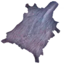        | Pelaje de mooncalf   | `Mooncalf_Byproduct`    | `BeastByProduct` | `ResourceInventory` |   999 |       Sí      |      No     |     No     | `item` |
|     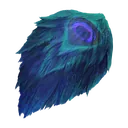     | Pelaje de escarbato  | `Niffler_Byproduct`     | `BeastByProduct` | `ResourceInventory` |   999 |       Sí      |      No     |     No     | `item` |
|             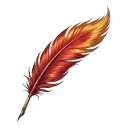            | Pluma de fénix       | `Phoenix_Byproduct`     | `BeastByProduct` | `ResourceInventory` |   999 |       Sí      |      No     |     No     | `item` |
| 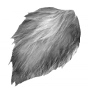 | Pelaje de puffskein  | `Puffskein_Byproduct`   | `BeastByProduct` | `ResourceInventory` |   999 |       Sí      |      No     |     No     | `item` |
|          | Pelaje de thestral   | `Thestral_Byproduct`    | `BeastByProduct` | `ResourceInventory` |   999 |       Sí      |      No     |     No     | `item` |
|         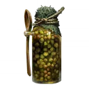        | Verruga de sapo      | `Toad_Byproduct`        | `BeastByProduct` | `ResourceInventory` |   999 |       Sí      |      No     |     No     | `item` |
|      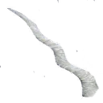      | Pelo de unicornio    | `Unicorn_Byproduct`     | `BeastByProduct` | `ResourceInventory` |   999 |       Sí      |      No     |     No     | `item` |

## Plant By Product

|                                                        Icono                                                       | Nombre                       | Item ID                 | Tipo             | Holder              | Stack | Inventariable | Persistente | Consumible | Kind   |
| :----------------------------------------------------------------------------------------------------------------: | ---------------------------- | ----------------------- | ---------------- | ------------------- | ----: | :-----------: | :---------: | :--------: | ------ |
|              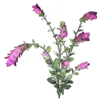             | Hojas de dictamo             | `Dittany_Byproduct`     | `PlantByProduct` | `ResourceInventory` |   999 |       Sí      |      No     |     No     | `item` |
|     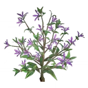    | Tallo de descurainia sophia  | `Fluxweed_Byproduct`    | `PlantByProduct` | `ResourceInventory` |   999 |       Sí      |      No     |     No     | `item` |
|          | Brotes de descurainia        | `Knotgrass_Byproduct`   | `PlantByProduct` | `ResourceInventory` |   999 |       Sí      |      No     |     No     | `item` |
|        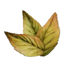       | Hojas de malva               | `Mallowsweet_Byproduct` | `PlantByProduct` | `ResourceInventory` |   999 |       Sí      |      No     |     No     | `item` |
| 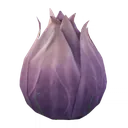 | Fruto de higuera hidropónica | `Shrivelfig_Byproduct`  | `PlantByProduct` | `ResourceInventory` |   999 |       Sí      |      No     |     No     | `item` |

## Enemy Drop

|                                              Icono                                             | Nombre            | Item ID           | Tipo        | Holder              | Stack | Inventariable | Persistente | Consumible | Kind   |
| :--------------------------------------------------------------------------------------------: | ----------------- | ----------------- | ----------- | ------------------- | ----: | :-----------: | :---------: | :--------: | ------ |
| 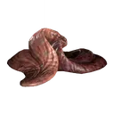 | Lengua de dugbog  | `Dugbog_Pellet`   | `EnemyDrop` | `ResourceInventory` |   999 |       Sí      |      No     |     No     | `item` |
| 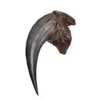 | Colmillo de araña | `Spider_Fang`     | `EnemyDrop` | `ResourceInventory` |   999 |       Sí      |      No     |     No     | `item` |
|           | Olor de muerto    | `StenchOfTheDead` | `EnemyDrop` | `ResourceInventory` |   999 |       Sí      |      No     |     No     | `item` |
|    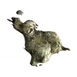    | Moco de trol      | `TrollMucus`      | `EnemyDrop` | `ResourceInventory` |   999 |       Sí      |      No     |     Sí     | `item` |
|  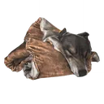  | Piel de lobo      | `Wolf_Byproduct`  | `EnemyDrop` | `ResourceInventory` |   999 |       Sí      |      No     |     No     | `item` |

## Sanctuary Item

|                                            Icono                                           | Nombre | Item ID      | Tipo            | Holder              | Stack | Inventariable | Persistente | Consumible | Kind   |
| :----------------------------------------------------------------------------------------: | ------ | ------------ | --------------- | ------------------- | ----: | :-----------: | :---------: | :--------: | ------ |
| 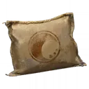 | Abono  | `Fertiliser` | `SanctuaryItem` | `ResourceInventory` |   999 |       Sí      |      No     |     No     | `item` |

## Special

|                                        Icono                                       | Nombre   | Item ID | Tipo      | Holder              | Stack | Inventariable | Persistente | Consumible | Kind   |
| :--------------------------------------------------------------------------------: | -------- | ------- | --------- | ------------------- | ----: | :-----------: | :---------: | :--------: | ------ |
| 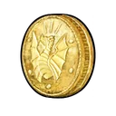 | Galleons | `Knuts` | `Special` | `ResourceInventory` |   999 |       Sí      |      No     |     No     | `item` |

## Resource

|                                                              Icono                                                             | Nombre                                 | Item ID                | Tipo       | Holder              | Stack | Inventariable | Persistente | Consumible | Kind   |
| :----------------------------------------------------------------------------------------------------------------------------: | -------------------------------------- | ---------------------- | ---------- | ------------------- | ----: | :-----------: | :---------: | :--------: | ------ |
|                     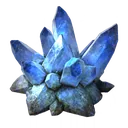                    | Piedra lunar                           | `Moonstone`            | `Resource` | `ResourceInventory` |   999 |       Sí      |      No     |     No     | `item` |
|                           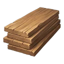                          | Madera                                 | `Timber`               | `Resource` | `ResourceInventory` |   999 |       Sí      |      No     |     No     | `item` |
|                   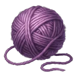                   | Ovillo de lana                         | `BallOfYarn`           | `Resource` | `ResourceInventory` |   999 |       Sí      |      No     |     No     | `item` |
|                      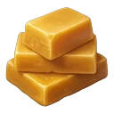                      | Cera de abeja                          | `Beeswax`              | `Resource` | `ResourceInventory` |   999 |       Sí      |      No     |     No     | `item` |
|                            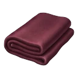                           | Tela                                   | `Cloth`                | `Resource` | `ResourceInventory` |   999 |       Sí      |      No     |     No     | `item` |
|                    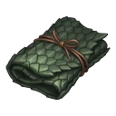                   | Piel de dragón                         | `DragonHide`           | `Resource` | `ResourceInventory` |   999 |       Sí      |      No     |     No     | `item` |
|                            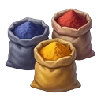                            | Tinte                                  | `Dye`                  | `Resource` | `ResourceInventory` |   999 |       Sí      |      No     |     No     | `item` |
|                         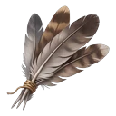                         | Plumas                                 | `Feathers`             | `Resource` | `ResourceInventory` |   999 |       Sí      |      No     |     No     | `item` |
|                     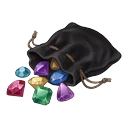                    | Piedra preciosa                        | `Gemstone`             | `Resource` | `ResourceInventory` |   999 |       Sí      |      No     |     No     | `item` |
|                   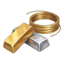                   | Oro y plata                            | `GoldAndSilver`        | `Resource` | `ResourceInventory` |   999 |       Sí      |      No     |     No     | `item` |
|                          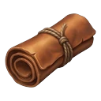                          | Cuero                                  | `Leather`              | `Resource` | `ResourceInventory` |   999 |       Sí      |      No     |     No     | `item` |
|                           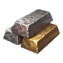                           | Metal                                  | `Metal`                | `Resource` | `ResourceInventory` |   999 |       Sí      |      No     |     No     | `item` |
|                    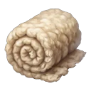                   | Lana sin procesar                      | `RawWool`              | `Resource` | `ResourceInventory` |   999 |       Sí      |      No     |     No     | `item` |
|                            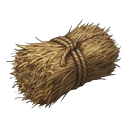                           | Paja                                   | `Straw`                | `Resource` | `ResourceInventory` |   999 |       Sí      |      No     |     No     | `item` |
|                           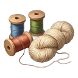                           | Hilo                                   | `Thread`               | `Resource` | `ResourceInventory` |   999 |       Sí      |      No     |     No     | `item` |
|                                  | Botella de cristal                     | `GlassBottle`          | `Resource` | `ResourceInventory` |   999 |       Sí      |      No     |     No     | `item` |
|                                  | Caldero de latón                       | `BrassCauldron`        | `Resource` | `ResourceInventory` |   999 |       Sí      |      No     |     No     | `item` |
|                 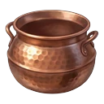                | Caldero de cobre                       | `CopperCauldron`       | `Resource` | `ResourceInventory` |   999 |       Sí      |      No     |     No     | `item` |
|                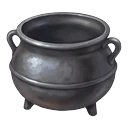                | Caldero de peltre                      | `PewterCauldron`       | `Resource` | `ResourceInventory` |   999 |       Sí      |      No     |     No     | `item` |
|                                 | Caldero de plata                       | `SilverCauldron`       | `Resource` | `ResourceInventory` |   999 |       Sí      |      No     |     No     | `item` |
|                                            | Tintero                                | `BottleOfInk`          | `Resource` | `ResourceInventory` |   999 |       Sí      |      No     |     No     | `item` |
|                                              | Tinta azul                             | `BlueInk`              | `Resource` | `ResourceInventory` |   999 |       Sí      |      No     |     No     | `item` |
|                              | Pergamino en blanco                    | `BlankParchment`       | `Resource` | `ResourceInventory` |   999 |       Sí      |      No     |     No     | `item` |
|                                | Pluma de cisne                         | `SwanFeatherQuill`     | `Resource` | `ResourceInventory` |   999 |       Sí      |      No     |     No     | `item` |
|                                       | Sello y lacre                          | `SealAndWax`           | `Resource` | `ResourceInventory` |   999 |       Sí      |      No     |     No     | `item` |
|                                    | Sobre sellado                          | `SealedEnvelope`       | `Resource` | `ResourceInventory` |   999 |       Sí      |      No     |     No     | `item` |
|                                               | Tinta roja                             | `RedInk`               | `Resource` | `ResourceInventory` |   999 |       Sí      |      No     |     No     | `item` |
|  | Sello de caucho y almohadilla de tinta | `RubberStampAndInkPad` | `Resource` | `ResourceInventory` |   999 |       Sí      |      No     |     No     | `item` |
|                                                       | Carne                                  | `Meat`                 | `Resource` | `ResourceInventory` |   999 |       Sí      |      No     |     No     | `item` |
|                                                  | Canela                                 | `Cinnamon`             | `Resource` | `ResourceInventory` |   999 |       Sí      |      No     |     No     | `item` |
|                                                  | Especias                               | `Spices`               | `Resource` | `ResourceInventory` |   999 |       Sí      |      No     |     No     | `item` |
|                                                 | Patatas                                | `Potatoes`             | `Resource` | `ResourceInventory` |   999 |       Sí      |      No     |     No     | `item` |
|                                                     | Azúcar                                 | `Sugar`                | `Resource` | `ResourceInventory` |   999 |       Sí      |      No     |     No     | `item` |
|                                              | Verduras                               | `Vegetables`           | `Resource` | `ResourceInventory` |   999 |       Sí      |      No     |     No     | `item` |
|                                   | Rueda de queso                         | `WheelOfCheese`        | `Resource` | `ResourceInventory` |   999 |       Sí      |      No     |     No     | `item` |
|                                           | Hojas de té                            | `TeaLeaves`            | `Resource` | `ResourceInventory` |   999 |       Sí      |      No     |     No     | `item` |
|                                | Comida en mal estado                   | `SpoiledFood`          | `Resource` | `ResourceInventory` |   999 |       Sí      |      No     |     No     | `item` |
|                                                | Frutos secos                           | `Nuts`                 | `Resource` | `ResourceInventory` |   999 |       Sí      |      No     |     No     | `item` |
|                                                  | Setas                                  | `Mushrooms`            | `Resource` | `ResourceInventory` |   999 |       Sí      |      No     |     No     | `item` |
|                                                       | Malta                                  | `Malt`                 | `Resource` | `ResourceInventory` |   999 |       Sí      |      No     |     No     | `item` |
|                                                       | Miel                                   | `Honey`                | `Resource` | `ResourceInventory` |   999 |       Sí      |      No     |     No     | `item` |
|                                                      | Grano                                  | `Grain`                | `Resource` | `ResourceInventory` |   999 |       Sí      |      No     |     No     | `item` |
|                                                      | Fruta                                  | `Fruit`                | `Resource` | `ResourceInventory` |   999 |       Sí      |      No     |     No     | `item` |
|                                                     | Harina                                 | `Flour`                | `Resource` | `ResourceInventory` |   999 |       Sí      |      No     |     No     | `item` |
|                                                     | Pescado                                | `Fish`                 | `Resource` | `ResourceInventory` |   999 |       Sí      |      No     |     No     | `item` |
|                                                      | Huevos                                 | `Eggs`                 | `Resource` | `ResourceInventory` |   999 |       Sí      |      No     |     No     | `item` |
|                                                       | Nata                                   | `Cream`                | `Resource` | `ResourceInventory` |   999 |       Sí      |      No     |     No     | `item` |
|                                      | Granos de café                         | `CoffeeBeans`          | `Resource` | `ResourceInventory` |   999 |       Sí      |      No     |     No     | `item` |
|                                                      | Cacao                                  | `Cocoa`                | `Resource` | `ResourceInventory` |   999 |       Sí      |      No     |     No     | `item` |
|                                     | Queso cheddar                          | `CheddarCheese`        | `Resource` | `ResourceInventory` |   999 |       Sí      |      No     |     No     | `item` |

***

_Iconos cargados desde las URLs del catálogo. La visualización depende del soporte HTML del visor Markdown._
