# gafas y mascaras

**Total de prendas** · 43

Cada prenda utiliza un icono compartido.

| Iconos                                                                                                                   | Nombre                                          | ID        | Descripción                                                                                                                 |
| ------------------------------------------------------------------------------------------------------------------------ | ----------------------------------------------- | --------- | --------------------------------------------------------------------------------------------------------------------------- |
| 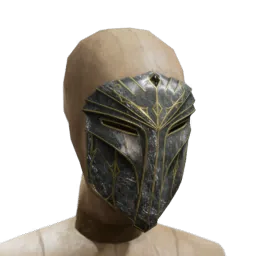                          | **Máscara legendaria**                          | Face\_001 | Máscara con diseños misteriosos                                                                                             |
| 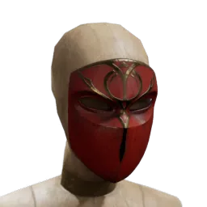                           | **Máscara sanguínea**                           | Face\_003 | Una máscara de color rojo sangre con un rostro inquietante y sin rasgos                                                     |
|          | **Gafas redondas con montura de plata**         | Face\_004 | Un par de gafas redondas con montura de plata                                                                               |
| 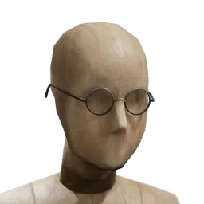           | **Gafas redondas con montura de oro**           | Face\_005 | Un par de gafas de oro normales con montura redonda                                                                         |
| 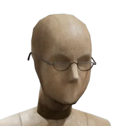     | **Gafas de medialuna con montura de plata**     | Face\_006 | Un par de gafas de montura plateada, con lentes en forma de media luna                                                      |
|        | **Gafas de medialuna con montura de oro**       | Face\_007 | Unas gafas de oro normales con montura de medialuna                                                                         |
| 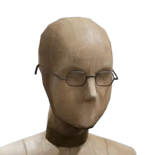      | **Gafas hexagonales con montura de plata**      | Face\_008 | Un par de gafas con montura plateada y lentes hexagonales                                                                   |
|         | **Gafas hexagonales con montura de oro**        | Face\_009 | Un par de gafas con montura dorada y lentes hexagonales                                                                     |
| 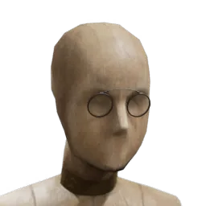                              | **Gafas de plata**                              | Face\_010 | Unas gafas de plata notables adornadas con una cadenita                                                                     |
|                                 | **Gafas de oro**                                | Face\_011 | Unas gafas de oro notables adornadas con una cadenita                                                                       |
|              | **Gafas de media montura de plata**             | Face\_012 | Un notable par de gafas de media montura de plata que elevará la opinión de los demás sobre ti                              |
| 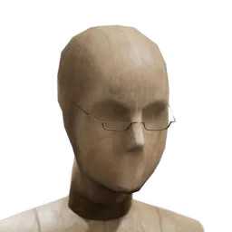               | **Gafas de media montura de oro**               | Face\_013 | Un notable par de gafas de media montura de oro que elevará la opinión de los demás sobre ti                                |
| 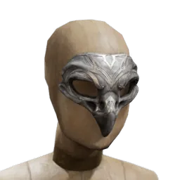                | **Máscara de calavera con pico**                | Face\_014 | Máscara cuyo parecido a una calavera con pico inspirará terror a tus enemigos                                               |
| 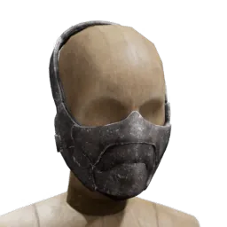                        | **Máscara de manicomio**                        | Face\_015 | Una máscara magnífica, forjada en metal para que parezca que acabas de escapar del manicomio                                |
| 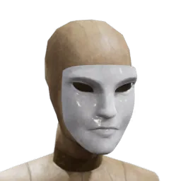                         | **Máscara de cerámica**                         | Face\_016 | Una máscara rara, adecuada para ocultar las expresiones faciales                                                            |
| 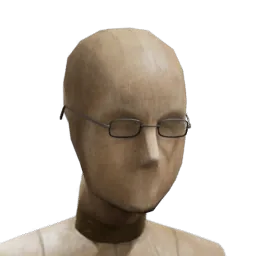    | **Gafas rectangulares con montura de plata**    | Face\_017 | Unas gafas de plata normales con montura rectangular                                                                        |
|       | **Gafas rectangulares con montura de oro**      | Face\_018 | Unas gafas de oro normales con montura rectangular                                                                          |
|                        | **Gafas de madera y oro**                       | Face\_019 | Un par estándar de anteojos con montura de madera y detalles dorados                                                        |
|                       | **Gafas de madera oscura**                      | Face\_020 | Un par estándar de anteojos con montura de madera oscura                                                                    |
| 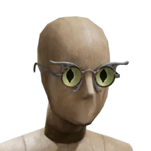           | **Gafas plateadas de ojos de dragón**           | Face\_021 | Gafas plateadas con una penetrante mirada de ojos de dragón                                                                 |
| 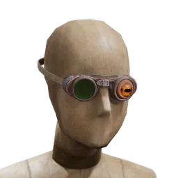 | **Gafas protectoras naranjas de ojo de tritón** | Face\_022 | Gafas protectoras bien equipadas con un ocular naranja parecido al de un tritón para aquellos orgullosos de ser excéntricos |
| 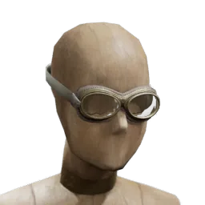                          | **Gafas de Quidditch**                          | Face\_023 | Un par de gafas de Quidditch bien equipadas para proteger los ojos del viento y mantener la vista fija en la Quaffle        |
| 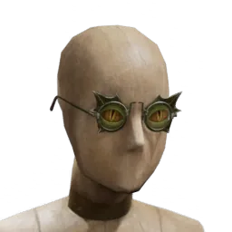              | **Gafas doradas de ojo de dragón**              | Face\_024 | Un par de gafas de oro bruñido que presentan los iris de un temible dragón                                                  |
|            | **Gafas redondas con cinta adhesiva**           | Face\_025 | Gafas redondas con cinta adhesiva en el puente                                                                              |
| 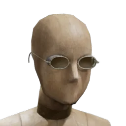            | **Gafas de protección solar azules**            | Face\_026 | Un par de gafas tintadas de azul para protegerte del sol o de una explosión de Bombarda                                     |
| 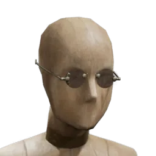                   | **Gafas de protección solar**                   | Face\_027 | Un par de gafas normales, redondas y tintadas, que impiden que te dé el sol en los ojos                                     |
|                       | **Gafas bifocales azules**                      | Face\_028 | Un par de gafas normales, ovaladas y tintadas en azul, con un juego extra para la visión periférica                         |
| 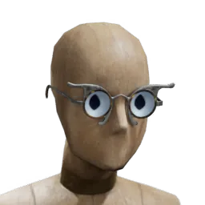                     | **Gafas de plata curiosas**                     | Face\_029 | Un par de gafas excéntricas de plata para ayudarte a ver el camino inusual hacia adelante                                   |
| 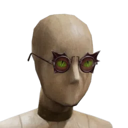            | **Gafas moradas con ojos de dragón**            | Face\_030 | Gafas con diseño de iris verde de dragón sobre una montura morada                                                           |
| 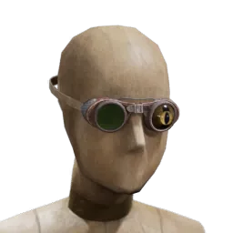             | **Gafas marrones de ojo de tritón**             | Face\_031 | Gafas legendarias con un ocular marrón que recuerda a un tritón, para los orgullosamente excéntricos                        |
| 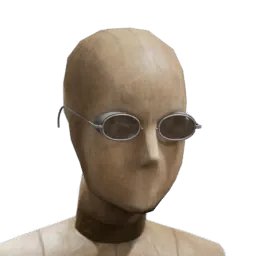                   | **Gafas de protección solar**                   | Face\_032 | Unas gafas ovaladas tintadas de buena calidad para proteger tus ojos del sol                                                |
| 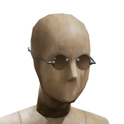                  | **Gafas tintadas sin montura**                  | Face\_033 | Unas gafas redondas estándar sin montura para proteger tus ojos del sol                                                     |
| 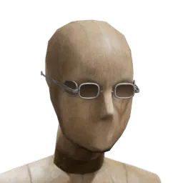                 | **Gafas periféricas plateadas**                 | Face\_034 | Unas gafas ovaladas con montura plateada, de excelente calidad, con un par adicional para la visión periférica              |
| 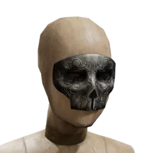                | **Máscara de las Artes Oscuras**                | Face\_035 | Una máscara de calavera, adornada con filigrana de plata                                                                    |
| 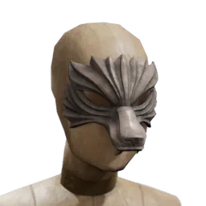                    | **Máscara de lobo vengador**                    | Face\_036 | Máscara con el rostro tallado de un lobo                                                                                    |
| 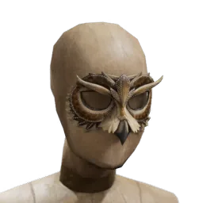                | **Máscara de lechuza vengadora**                | Face\_037 | Máscara con el rostro tallado de una lechuza                                                                                |
| 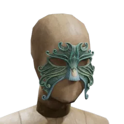                           | **Máscara de sirena**                           | Face\_038 | Máscara de sirena, para quien se encuentra como en casa en las profundidades del lago                                       |
| 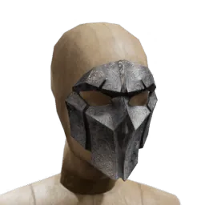                         | **Máscara de duelista**                         | Face\_039 | Una máscara para el formidable duelista                                                                                     |
| 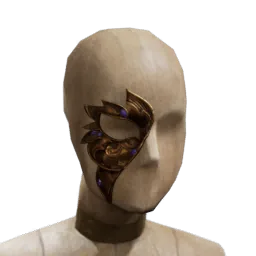                 | **Máscara de baile legendaria**                 | Face\_040 | Máscara de metal grabado y gemas de color añil, ideal para fiestas nocturnas y encuentros misteriosos                       |
| 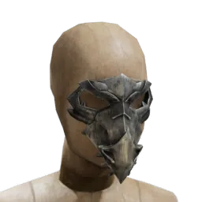                 | **Máscara del Cuervo Vengador**                 | Face\_041 | Una máscara con el rostro tallado de un cuervo                                                                              |
| 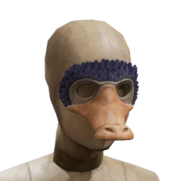                        | **Máscara de escarbato**                        | Face\_042 | Máscara de escarbato, para el detective escurridizo                                                                         |
| 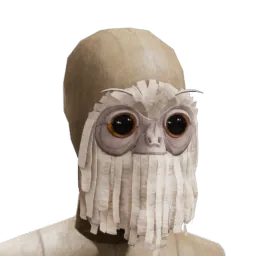                        | **Máscara de Demiguise**                        | Face\_043 | Una máscara de Demiguise para magos astutos                                                                                 |
| 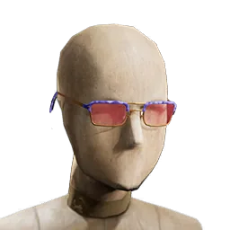         | **Gafas de profesor de Encantamientos**         | Face\_044 | Gafas de color lavanda y dorado inspiradas en el carácter juguetón del profesor de Encantamientos                           |
