# guantes

**Total de prendas** · 44

Cada prenda utiliza un icono compartido.

| Iconos                                                                                                                     | Nombre                                            | ID        | Descripción                                                                                                                                                      |
| -------------------------------------------------------------------------------------------------------------------------- | ------------------------------------------------- | --------- | ---------------------------------------------------------------------------------------------------------------------------------------------------------------- |
| 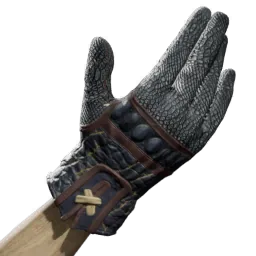                           | **Guantes legendarios**                           | Hand\_001 | Guantes bordados con diseños misteriosos                                                                                                                         |
| 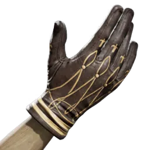        | **Guantes de explorador de las Highlands**        | Hand\_002 | Guantes de color marrón y dorado para los exploradores intrépidos                                                                                                |
| 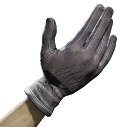                  | **Guantes de las Artes Oscuras**                  | Hand\_003 | Guantes con remaches negros                                                                                                                                      |
| 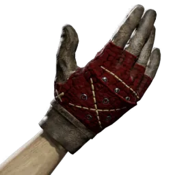        | **Guantes de herbólogo de piel de dragón**        | Hand\_004 | Guantes de piel de dragón, para manipular especímenes herbológicos venenosos                                                                                     |
| 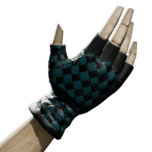         | **Guantes de calavera de los Ashwinders**         | Hand\_005 | Guantes de calavera góticos, para quien derrota a los Ashwinders                                                                                                 |
| 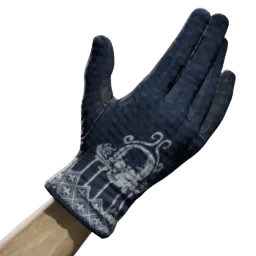                             | **Guantes a cuadros**                             | Hand\_006 | Unos guantes magníficos a cuadros                                                                                                                                |
| 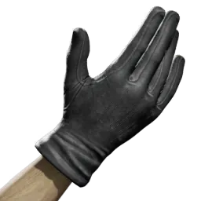                        | **Guantes de cuero negro**                        | Hand\_007 | Unos guantes normales de cuero negro                                                                                                                             |
| 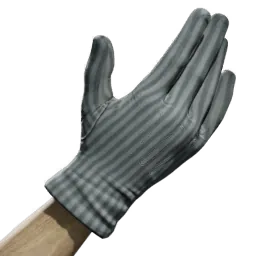                        | **Guantes a rayas verdes**                        | Hand\_008 | Unos guantes normales a rayas verdes                                                                                                                             |
| 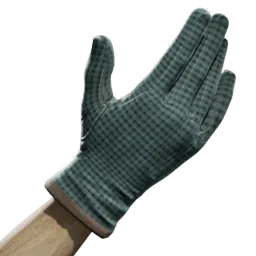                      | **Guantes a cuadros verdes**                      | Hand\_009 | Unos guantes normales estampados con cuadros verdes                                                                                                              |
| 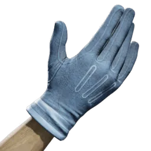                       | **Guantes de cuero azules**                       | Hand\_010 | Unos guantes normales de cuero de color azul                                                                                                                     |
| 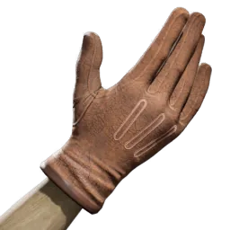                     | **Guantes de cuero marrones**                     | Hand\_011 | Unos guantes normales de cuero de color marrón                                                                                                                   |
| 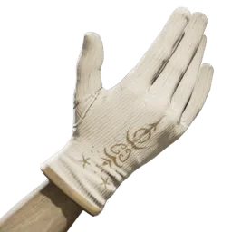          | **Guantes marfileños de factura élfica**          | Hand\_012 | Unos guantes normales de color marfil de factura élfica                                                                                                          |
| 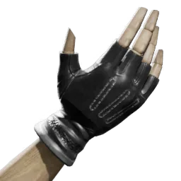                                | **Mitones negros**                                | Hand\_013 | Unos mitones normales de color negro                                                                                                                             |
| 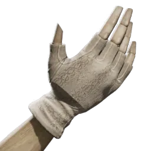                          | **Guantes de follonero**                          | Hand\_014 | Unos guantes normales de color verde oliva, ideales para armar jaleo                                                                                             |
| 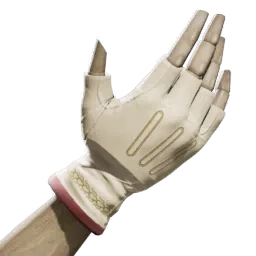                  | **Guantes adornados con salvia**                  | Hand\_015 | Unos guantes normales adornados con salvia                                                                                                                       |
| 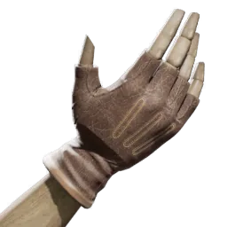              | **Mitones de cuero de color marrón**              | Hand\_016 | Unos mitones normales de cuero de color marrón                                                                                                                   |
| 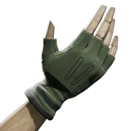                            | **Mitones de cazador**                            | Hand\_017 | Unos mitones normales con un tono verde cazador                                                                                                                  |
| 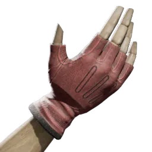                        | **Mitones de color caoba**                        | Hand\_018 | Unos mitones normales de color caoba                                                                                                                             |
| 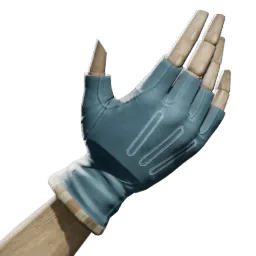                | **Mitones de color verde azulado**                | Hand\_019 | Unos mitones normales de color verde azulado                                                                                                                     |
| 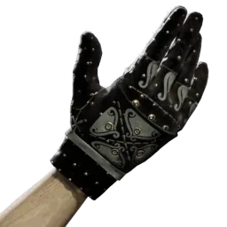                   | **Guantes con remaches negros**                   | Hand\_020 | Unos guantes magníficos con remaches negros                                                                                                                      |
| 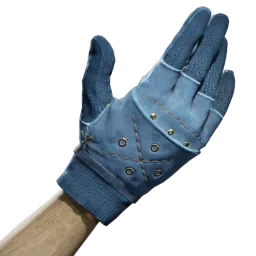               | **Guantes con remaches azul claro**               | Hand\_021 | Unos guantes notables con remaches azul claro                                                                                                                    |
| 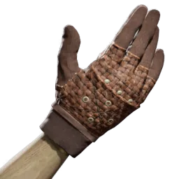                 | **Guantes con remaches de cedro**                 | Hand\_022 | Unos guantes notables con remaches de cedro                                                                                                                      |
| 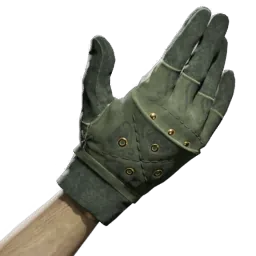                | **Guantes con remaches de bosque**                | Hand\_023 | Unos guantes notables con remaches de bosque                                                                                                                     |
| 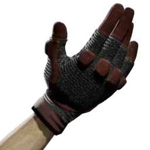                  | **Guantes de quidditch borgoña**                  | Hand\_024 | Unos guantes de quidditch notables en negro y marrón                                                                                                             |
| 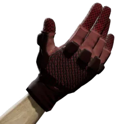               | **Guantes de quidditch escarlatas**               | Hand\_025 | Unos guantes de quidditch normales de color escarlata oscuro                                                                                                     |
| 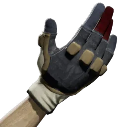               | **Guantes de capitán de quidditch**               | Hand\_026 | Guantes de quidditch para quien domina el terreno de juego                                                                                                       |
| 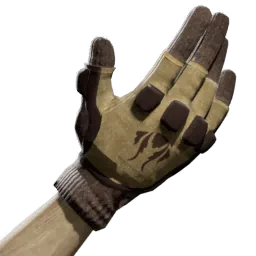            | **Guantes de quidditch de color ocre**            | Hand\_027 | Unos guantes de quidditch notables de color ocre                                                                                                                 |
| 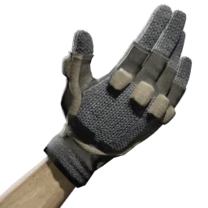                   | **Guantes de quidditch grises**                   | Hand\_028 | Unos guantes de quidditch notables de color gris                                                                                                                 |
| 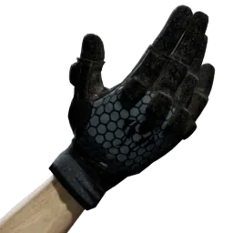              | **Guantes de quidditch invencibles**              | Hand\_029 | Unos guantes de quidditch notables de color negro con diseño de panal de abeja que te harán imparable en el campo                                                |
| 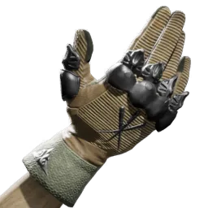                 | **Guantes de duelista forastero**                 | Hand\_030 | Unos guantes de duelista magníficos para los amantes de la naturaleza                                                                                            |
| 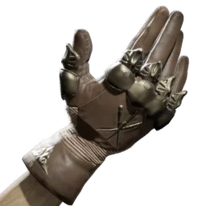            | **Guantes de leprechaun de la suerte**            | Hand\_031 | Guantes para el afortunado juerguista, que se obtienen al cumplir misiones secundarias                                                                           |
| 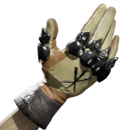                | **Guantes de duelista resistente**                | Hand\_032 | Unos guantes de duelista magníficos para los que no temen ensuciarse las manos                                                                                   |
| 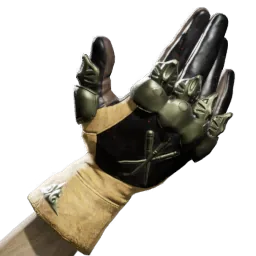              | **Guantes de duelista aguijoneador**              | Hand\_033 | Unos guantes de duelista magníficos para quienes atacan con la precisión de una abeja                                                                            |
| 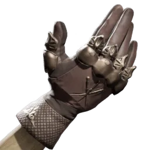                  | **Guantes de duelista refinado**                  | Hand\_034 | Unos guantes de duelista magníficos para los que pertenecen a la alta sociedad                                                                                   |
| 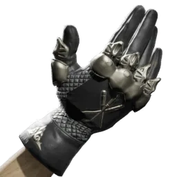      | **Guantes de duelista de las Artes Oscuras**      | Hand\_035 | Unos guantes de duelista magníficos para los que practican las Artes Oscuras                                                                                     |
| 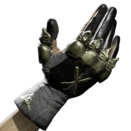                  | **Guantes de duelista elegante**                  | Hand\_036 | Unos guantes de duelista magníficos que añaden un toque de clase y elegancia a cualquier duelo                                                                   |
| 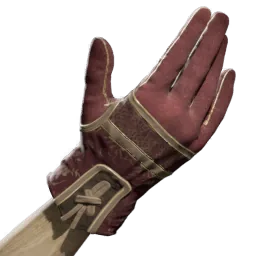                   | **Guantes de gala de Hogwarts**                   | Hand\_037 | Guantes para el fiel explorador de Hogwarts, que se obtienen al descubrir páginas de la Guía de campo de Hogwarts                                                |
| 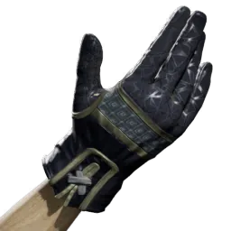                 | **Guantes de ébano ornamentales**                 | Hand\_038 | Unos guantes extraordinarios de color ébano con diseños ornamentales                                                                                             |
| 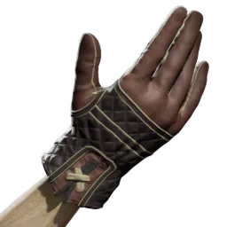                       | **Guantes de buscatesoros**                       | Hand\_039 | Guantes para aventureros consumados que se obtienen al seguir un mapa hasta llegar al tesoro secreto                                                             |
| 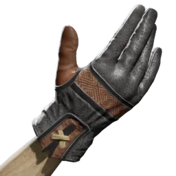        | **Guantes marrones y negros ornamentales**        | Hand\_040 | Unos guantes extraordinarios de color negro y marrón con diseños ornamentales                                                                                    |
| 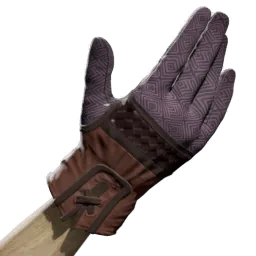 | **Guantes de campeón de la Pista de Convocación** | Hand\_041 | Guantes de color malva con diseños ornamentales, ganados tras vencer a todos los oponentes en la Pista de Convocación                                            |
| 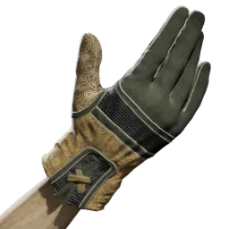                | **Guantes verde enebro decorados**                | Hand\_042 | Unos guantes extraordinarios de color verde enebro con diseños ornamentales                                                                                      |
| 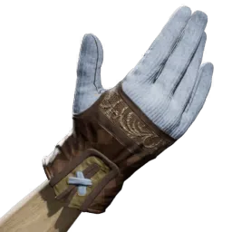                | **Guantes bicolores ornamentales**                | Hand\_043 | Unos guantes extraordinarios de color verde enebro con diseños ornamentales                                                                                      |
| 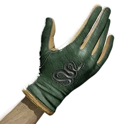         | **Guantes de profesor de Encantamientos**         | Hand\_044 | Un par de guantes verdes y dorados con una serpiente plateada bordada, inspirados en el profesor de Encantamientos favorito de todos y jefe de la casa Slytherin |
