# sombreros y gorros

**Total de prendas** · 72

Los iconos muestran las variantes de hombre y mujer y, cuando corresponde, las de cada casa.

| Iconos                                                                                                                                                                                                                                                                                                                          | Nombre                                           | ID        | Descripción                                                                                                         |
| ------------------------------------------------------------------------------------------------------------------------------------------------------------------------------------------------------------------------------------------------------------------------------------------------------------------------------- | ------------------------------------------------ | --------- | ------------------------------------------------------------------------------------------------------------------- |
| 
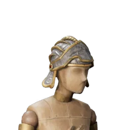

 Hombre  

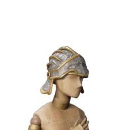

 Mujer
                                    | **Yelmo fabricado por duendes**                  | Head\_001 | Yelmo fabricado por duendes. El mejor de su categoría                                                               |
| 
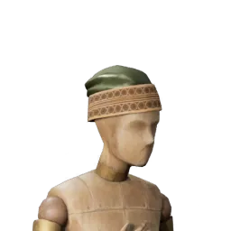

 Hombre  

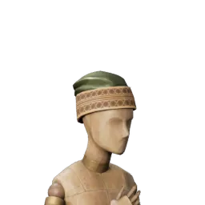

 Mujer
               | **Gorra de explorador de las Highlands**         | Head\_003 | Gorra esmeralda para exploradores                                                                                   |
| 
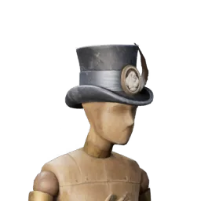

 Hombre  

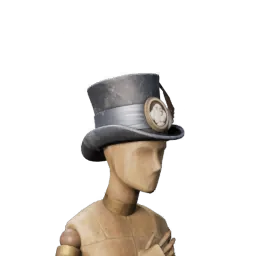

 Mujer
                                                       | **Sombrero de trol**                             | Head\_006 | Sombrero de trol, tan diferente como abominable                                                                     |
| 
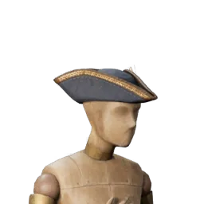

 Hombre  

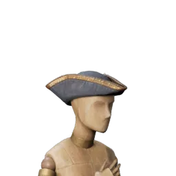

 Mujer
                                          | **Bicornio de buscatesoros**                     | Head\_007 | Bicornio para aventureros consumados                                                                                |
| 
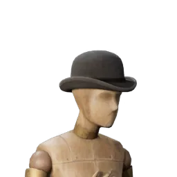

 Hombre  

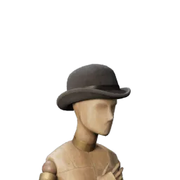

 Mujer
                                                               | **Bombín negro**                                 | Head\_008 | Un bombín negro normal, adecuado para importantes asuntos ministeriales                                             |
| 
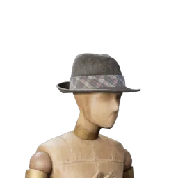

 Hombre  

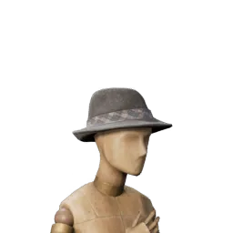

 Mujer
                                    | **Sombrero de fieltro elegante**                 | Head\_009 | Un elegante sombrero de fieltro con un estampado oscuro para los magos sensatos que prefieren pasar desapercibidos  |
| 
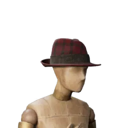

 Hombre  

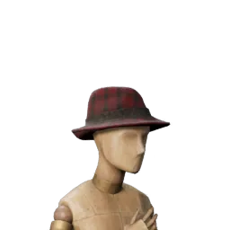

 Mujer
                         | **Sombrero de fieltro rojo sangre**              | Head\_010 | Un sombrero de fieltro normal de color rojo sangre                                                                  |
| 
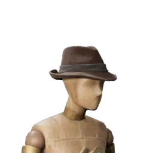

 Hombre  

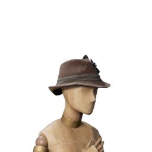

 Mujer
                     | **Sombrero de fieltro de clase alta**            | Head\_011 | Un sombrero de fieltro notable para brujas y magos de mundo                                                         |
| 
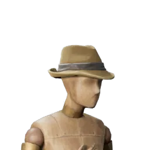

 Hombre  

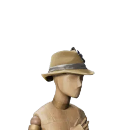

 Mujer
                                 | **Sombrero de fieltro florido**                  | Head\_012 | Un sombrero de fieltro normal con un apagado tono floral                                                            |
| 
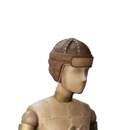

 Hombre  

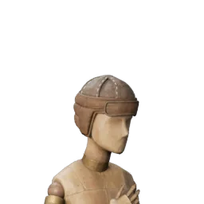

 Mujer
                             | **Casco de capitán de quidditch**                | Head\_013 | Casco de quidditch                                                                                                  |
| 
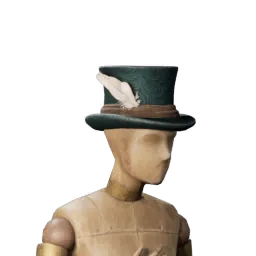

 Hombre  

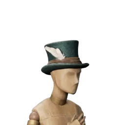

 Mujer
                                 | **Sombrero de copa de tendero**                  | Head\_014 | Un sombrero de copa hecho con un tejido excéntrico para completar el conjunto de tendero                            |
| 
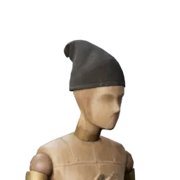

 Hombre  

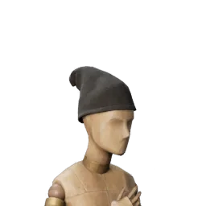

 Mujer
                                             | **Gorro de primer curso**                        | Head\_015 | Un gorro ceremonial normal que llevan los alumnos de primer curso en Hogwarts                                       |
| 
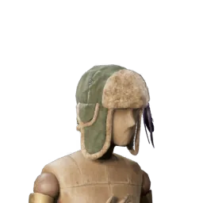

 Hombre  

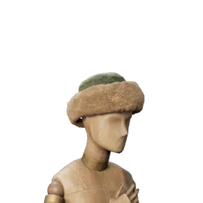

 Mujer
                                                             | **Gorro de piel**                                | Head\_016 | Un gorro de piel notable y la mar de calentito para soportar mejor los inviernos en Hogwarts                        |
| 
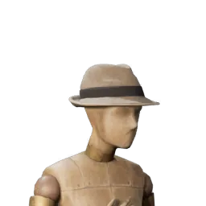

 Hombre  

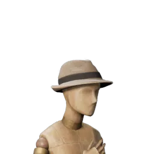

 Mujer
                           | **Sombrero de fieltro resistente**               | Head\_017 | Un sombrero de fieltro normal de color tostado, ideal para reforzar tu estilo recio                                 |
| 
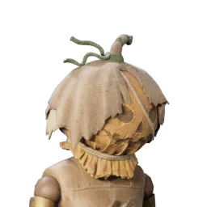

 Hombre  

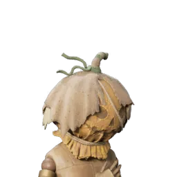

 Mujer
                       | **Máscara de calabaza de Halloween**             | Head\_018 | Máscara de calabaza para las festividades de octubre                                                                |
| 
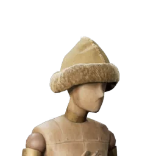

 Hombre  

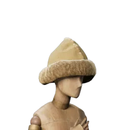

 Mujer
                   | **Sombrero invernal de piel de oveja**           | Head\_019 | Un sombrero de invierno notable, hecho de piel de oveja y lana                                                      |
| 
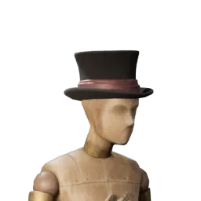

 Hombre  

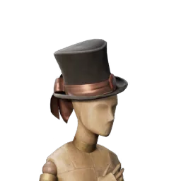

 Mujer
                               | **Sombrero de copa distinguido**                 | Head\_020 | Un sombrero de copa notable para los magos y las brujas más distinguidos                                            |
| 
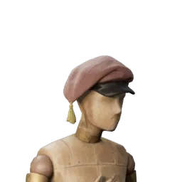

 Hombre  

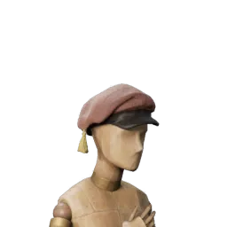

 Mujer
                                                     | **Gorra de golfillo**                            | Head\_021 | Una gorra granate legendaria que te ayudará a mezclarte con los vagabundos                                          |
| 
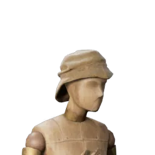

 Hombre  

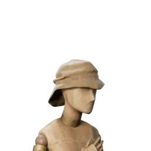

 Mujer
                                                   | **Sombrero de nómada**                           | Head\_022 | Un sombrero normal, adecuado para viajeros sencillos y muy útil para protegerse del sol                             |
| 
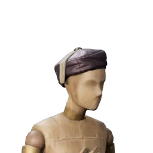

 Hombre  

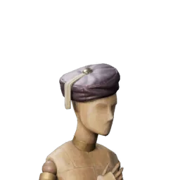

 Mujer
                                                           | **Kufi con borla**                               | Head\_023 | Un kufi notable con una borla                                                                                       |
| 
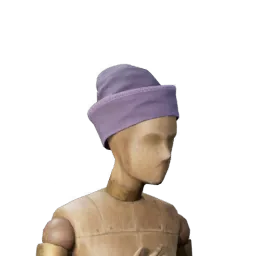

 Hombre  

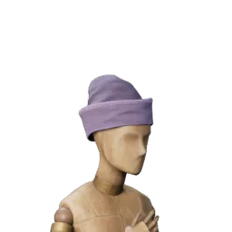

 Mujer
                                               | **Gorro de dormir azul**                         | Head\_024 | Un gorro de dormir azul normal para personas que duermen en paz y sonámbulos elegantes                              |
| 
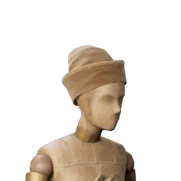

 Hombre  

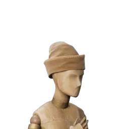

 Mujer
                  | **Gorro de dormir de color tostado**             | Head\_025 | Un gorro de dormir normal de color tostado, agradable a la vista y cómodo en la cabeza                              |
| 
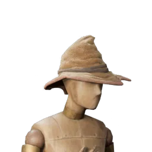

 Hombre  

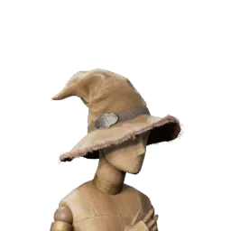

 Mujer
                                 | **Sombrero de herbólogo claro**                  | Head\_026 | Un sombrero con ala magnífico para mantener a raya el sol… y el veneno de tentácula venenosa                        |
| 
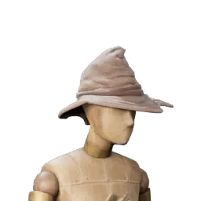

 Hombre  

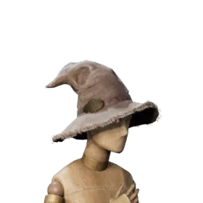

 Mujer
                               | **Sombrero de herbólogo oscuro**                 | Head\_027 | Un sombrero con ala normal que proyecta una sombra lo bastante grande como para ahuyentar a los gnomos de tu jardín |
| 
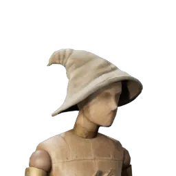

 Hombre  

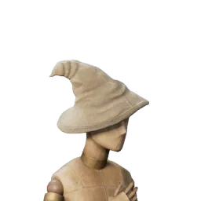

 Mujer
                                                             | **Gorro de hada**                                | Head\_028 | Un gorro normal con forma de seta y aspecto travieso                                                                |
| 

 Hombre  

 Mujer
                                           | **Sombrero de paja claro**                       | Head\_029 | Un sombrero de ala ancha normal hecho de paja, ideal para los días de sol                                           |
| 

 Hombre  

 Mujer
                                         | **Sombrero de paja oscuro**                      | Head\_030 | Un sombrero de ala ancha oscuro magnífico, ideal para los días de sol                                               |
| 

 Hombre  

 Mujer
                                   | **Gorro de hechicero clásico**                   | Head\_031 | Un gorro negro puntiagudo normal que, a lo largo de la historia, han llevado magos y brujas de todo tipo            |
| 

 Hombre  

 Mujer
                             | **Gorro de hechicero del bosque**                | Head\_032 | Un gorro normal con un diseño rústico y algo desgastado, perfecto para la magia campestre                           |
| 

 Hombre  

 Mujer
                                                           | **Boina de cuero**                               | Head\_033 | Una boina de cuero normal para magos y brujas de clase trabajadora                                                  |
| 

 Hombre  

 Mujer
                                                               | **Boina oscura**                                 | Head\_034 | Una boina oscura normal para magos y brujas de clase trabajadora                                                    |
| 

 Hombre  

 Mujer
                         | **Gorra de elaborador de pociones**              | Head\_035 | Gorra protectora para elaborar pociones                                                                             |
| 

 Hombre  

 Mujer
                                                           | **Sombrero verde**                               | Head\_036 | Un sombrero normal de color verde con forma de enredadera                                                           |
| 

 Hombre  

 Mujer
                                                                       | **Chistera**                                     | Head\_037 | Un sombrero de copa normal que, aunque elegante, no sirve para sacar conejos de dentro                              |
| 

 Hombre  

 Mujer
                                      | **Sombrero de copa desgastado**                  | Head\_038 | Un sombrero de copa desgastado normal que, a pesar de estar un poco hecho polvo, tiene mucho carácter               |
| 

 Hombre  

 Mujer
                                                   | **Gorro de Herodiana**                           | Head\_039 | Gorro que en su día llevó la famosa Herodiana                                                                       |
| 

 Hombre  

 Mujer
                                                      | **Turbante estampado**                           | Head\_040 | Un notable turbante gris y negro con un estampado complejo                                                          |
| 

 Hombre  

 Mujer
                                               | **Gorro de dormir gris**                         | Head\_041 | Un gorro de dormir normal de color gris, perfecto para pasarse la noche estudiando Historia de la Magia             |
| 

 Hombre  

 Mujer
                                                                   | **Boina azul**                                   | Head\_042 | Una boina azul normal para magos y brujas de clase trabajadora                                                      |
| 

 Hombre  

 Mujer
                                         | **Gorro de hechicero añil**                      | Head\_043 | Notable gorro de hechicero de intenso color añil, cosido con cuidado y decorado con una hebilla                     |
| 

 Hombre  

 Mujer
                                 | **Gorro de hechicero elegante**                  | Head\_044 | Un sombrero notable, elegante y a la moda, hecho con un tejido aterciopelado                                        |
| 

 Hombre  

 Mujer
                         | **Gorro de hechicero extravagante**              | Head\_045 | Notable gorro de hechicero de color malva con un bucle extravagante en la punta                                     |
| 

 Hombre  

 Mujer
                                                                 | **Boina malva**                                  | Head\_046 | Una boina normal de color malva que muestra tu aprecio por Beauxbatons                                              |
| 

 Hombre  

 Mujer
               | **Sombrero de sastre de revelasecretos**         | Head\_047 | Sombrero de sastre confeccionado en damasco para un modista consumado                                               |
| 

 Hombre  

 Mujer
                               | **Gorro de dormir extravagante**                 | Head\_048 | Gorro de dormir con colores extravagantes para quien deambula por las noches                                        |
| 

 Hombre  

 Mujer
                                           | **Gorro del renacimiento**                       | Head\_049 | Un gorro notable con un aire renacentista que te ayudará a acceder a tu bardo interior                              |
| 

 Hombre  

 Mujer
                 | **Gorro de hechicero de color ciruela**          | Head\_050 | Un gorro notable de color ciruela                                                                                   |
| 

 Hombre  

 Mujer
                             | **Sombrero de piel de escarbato**                | Head\_051 | Sombrero de piel de escarbato                                                                                       |
| 

 Hombre  

 Mujer
                                                   | **Yelmo de matarañas**                           | Head\_052 | Yelmo para el más valiente asesino de arácnidos                                                                     |
| 

 Hombre  

 Mujer
                               | **Sombrero de gala de Hogwarts**                 | Head\_053 | Sombrero para el fiel explorador de Hogwarts                                                                        |
| 

 Hombre  

 Mujer
                                                   | **Sombrero de agente**                           | Head\_054 | Sombrero de agente para las figuras de autoridad                                                                    |
| 

 Hombre  

 Mujer
                           | **Sombrero de copa vincapervinca**               | Head\_055 | Un sombrero de copa magnífico de color vincapervinca oscuro                                                         |
| 

 Hombre  

 Mujer
                                               | **Sombrero malva suave**                         | Head\_056 | Un sombrero puntiagudo magnífico en un delicado color malva para magos y brujas a la última moda                    |
| 

 Hombre  

 Mujer
                   | **Sombrero de bromista jefe de Zonko**           | Head\_057 | Sombrero de copa para bromistas                                                                                     |
| 

 Hombre  

 Mujer
                               | **Sombrero de fieltro mecánico**                 | Head\_058 | Un sombrero de fieltro magnífico de color marrón cedro con una banda estampada con engranajes                       |
| 

 Hombre  

 Mujer
                 | **Sombrero de leprechaun de la suerte**          | Head\_059 | Sombrero de copa de un deslumbrante verde irlandés para el afortunado juerguista                                    |
| 

 Hombre  

 Mujer
                                         | **Gorro de dormir a rayas**                      | Head\_060 | Un gorro de dormir normal decorado con rayas (porque el dormir no está reñido con la elegancia)                     |
| 

 Hombre  

 Mujer
                                                       | **Sombrero de paja**                             | Head\_061 | Un sombrero magnífico de paja con una cinta de color verde amarillento                                              |
| 

 Hombre  

 Mujer
                             | **Gorro de hechicero de retales**                | Head\_062 | Magnífico gorro de hechicero que combina varios tonos de tela verde                                                 |
| 

 Hombre  

 Mujer
                         | **Sombrero de cachemira llamativo**              | Head\_063 | Un sombrero extraordinario con un estampado de cachemira blanco y negro                                             |
| 

 Hombre  

 Mujer
                                             | **Sombrero de astrónomo**                        | Head\_064 | Sombrero adecuado para los amantes de las estrellas                                                                 |
| 

 Hombre  

 Mujer
                                         | **Gorro de dormir rústico**                      | Head\_065 | Un gorro de dormir normal cuyo diseño recuerda a la corteza de un árbol                                             |
| 

 Hombre  

 Mujer
                                 | **Gorro de hechicero de cuero**                  | Head\_066 | Magnífico gorro de hechicero de resistente cuero que te hará sentir como todo un experto                            |
| 

 Hombre  

 Mujer
                             | **Sombrero de telaraña opulento**                | Head\_067 | Un sombrero extraordinario de un vívido color verde azulado con unas telarañas geométricas                          |
| 

 Hombre  

 Mujer
                             | **Gorro de hechicero verde hada**                | Head\_068 | Magnífico gorro de hechicero de un delicado verde con un aura feérica                                               |
| 

 Hombre  

 Mujer
                                                         | **Boina bizantina**                              | Head\_069 | Una boina normal con un cautivador diseño geométrico de estilo bizantino                                            |
| 

 Hombre  

 Mujer
               | **Gorro de hechicero de espantapájaros**         | Head\_070 | Gorro de hechicero normal, hecho de arpillera, que podría asustar a los cuervos de tus campos                       |
| 

 Hombre  

 Mujer
                                   | **Sombrero de copa escarlata**                   | Head\_071 | Un sombrero de copa notable de color escarlata con una sola pluma de color azul vivo que lo hace destacar           |
| 

 Hombre  

 Mujer
                               | **Gorro de hechicero de encaje**                 | Head\_072 | Notable gorro de hechicero, decorado con un encaje fino y delicado                                                  |
| 

 Hombre  

 Mujer
                             | **Sombrero de las Artes Oscuras**                | Head\_073 | Un sombrero usado por quienes están en contacto con el lado más tenebroso de la magia                               |
| 

 Hombre  

 Mujer
 | **Sombrero de guarnición de las Artes Oscuras**  | Head\_074 | Un sombrero usado por quienes están en contacto con el lado más tenebroso de la magia                               |
| 

 Hombre  

 Mujer
  | **Kufi con borla de profesor de Encantamientos** | Head\_075 | Kufi lavanda con ribetes dorados y borla que evoca la sabiduría y alegría del profesor de Encantamientos            |
