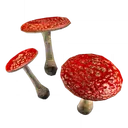
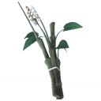
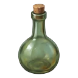
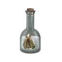
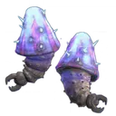
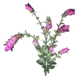
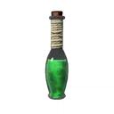
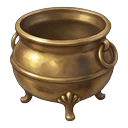

# lumos recetas

**Total de recetas** · 2

## Categoría 1

**Pociones** · 2

### Poción de invisibilidad

**ID** · brew\_invisibility

**Conocimiento** · Rol requerido · Pocionista

**Estación** · Mesa de pociones

**Ingredientes**

| Icono                                                                                        | Nombre                          | ID                          | Cantidad | Nota |
| -------------------------------------------------------------------------------------------- | ------------------------------- | --------------------------- | -------- | ---- |
|  | Sombreros de champiñón saltarín | LeapingToadstool\_Byproduct | × 2      | —    |
|         | Brotes de descurainia           | Knotgrass\_Byproduct        | × 1      | —    |
|                  | Botella de cristal              | GlassBottle                 | × 1      | —    |

**Resultados**

| Icono                                                                                | Nombre                  | ID                 | Cantidad | Nota |
| ------------------------------------------------------------------------------------ | ----------------------- | ------------------ | -------- | ---- |
|  | Poción de invisibilidad | InvisibilityPotion | × 1      | —    |

### Poción herbovitalizante

**ID** · brew\_wiggenweld

**Conocimiento** · Receta pública

**Ingredientes**

| Icono                                                                           | Nombre             | ID                 | Cantidad | Nota |
| ------------------------------------------------------------------------------- | ------------------ | ------------------ | -------- | ---- |
|  | Zumo de Horklump   | HorklumpJuice      | × 2      | —    |
|        | Hojas de dictamo   | Dittany\_Byproduct | × 1      | —    |
|     | Botella de cristal | GlassBottle        | × 1      | —    |

**Resultados**

| Icono                                                                           | Nombre                  | ID            | Cantidad | Nota |
| ------------------------------------------------------------------------------- | ----------------------- | ------------- | -------- | ---- |
|  | Poción herbovitalizante | WoundCleaning | × 1      | —    |

**Herramientas**

| Icono                                                                          | Nombre           | ID            | Cantidad | Nota |
| ------------------------------------------------------------------------------ | ---------------- | ------------- | -------- | ---- |
|  | Caldero de latón | brasscauldron | × 1      | —    |
